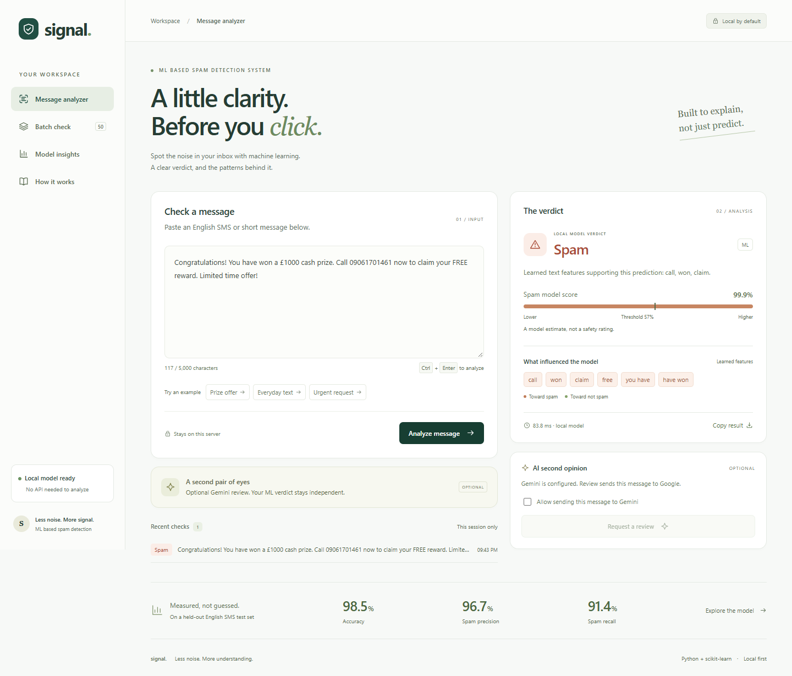

# ML Based Spam Detection System

**Signal** is a machine learning spam detector with an explainable local classifier and an optional Gemini second opinion. It classifies English SMS and short messages, shows the features behind each verdict, and supports batch analysis.



More views: [batch checking](docs/screenshots/batch.png), [model insights](docs/screenshots/model.png), [mobile layout](docs/screenshots/mobile.png).

## Features

- Responsive interface with message analysis, batch checking, model insights, and a walkthrough.
- Local predictions using word and character TF-IDF features with logistic regression.
- Spam model score, a visible decision threshold, and feature contributions from the trained model.
- Human-review prompts for scores near the threshold or messages with few familiar word features.
- Up to 50 messages per batch and CSV export with spreadsheet formula protection.
- Optional Gemini review, reply suggestions, and neutral rewriting, with explicit consent before sending text.
- Session-only recent checks. Submitted messages are not written to a database or application log.
- Reproducible training, a credited dataset, held-out evaluation, and backend and browser checks.

## Quick start

Python **3.13** is the tested version. The trained model is included, so training and an AI key are unnecessary to run the app.

```powershell
git clone https://github.com/akhil2892/ml-based-spam-detection-system.git
cd ml-based-spam-detection-system
python -m venv .venv
.\.venv\Scripts\python.exe -m pip install -r requirements.txt
.\.venv\Scripts\python.exe app.py
```

Open **http://127.0.0.1:5000**. On macOS/Linux, use `.venv/bin/python` in place of `.\.venv\Scripts\python.exe`.

`final-fixed-app.py` remains as a compatibility entry point and starts the same application. `app.py` is the maintained entry point.

For a WSGI server, after activating your environment:

```bash
waitress-serve --listen=127.0.0.1:5000 wsgi:app
```

## The machine learning pipeline

```text
English message
   ├── Word TF-IDF: unigrams + bigrams
   └── Character TF-IDF: 3–5 character fragments within word boundaries
                 ↓ weighted feature union
        Balanced logistic regression
                 ↓ validation-selected threshold
          Spam / Not spam + learned evidence
```

Word features capture terms and short phrases. Character features supply information about fragments and spelling variations. Both vectorizers use sublinear term frequency, Unicode accent handling, and a minimum document frequency of two. Stop words are retained because short conversational messages can contain useful common words.

The included pipeline uses **8,181 word features**, **27,164 character features**, regularization `C=8`, and a **0.57** classification threshold. These settings are recorded in [models/metrics.json](models/metrics.json). The classifier and vectorizers are saved together, and startup verifies their artifact checksum against the evaluation report.

Explanations use `TF-IDF feature value × learned classifier coefficient`. Positive contributions push toward spam; negative contributions push toward not spam. The API includes the intercept and the sum of all feature contributions. The UI shows a small selection of the strongest word features; it is not a complete causal explanation.

The spam score is an **uncalibrated model estimate**, not a safety rating. There are no manually added confidence points. The review prompts use a proximity band of 0.12 around the threshold or word-vocabulary coverage below 20%; those prompts are heuristics, not an independently validated uncertainty model.

## Evaluation

Source: [UCI SMS Spam Collection](https://archive.ics.uci.edu/dataset/228/sms%2Bspam%2Bcollection), credited to **Tiago Almeida and José María Gómez Hidalgo**. The dataset is licensed under [CC BY 4.0](https://creativecommons.org/licenses/by/4.0/); see [data/README.md](data/README.md) for attribution and download details.

Training parses **5,574 messages**, removes **415 duplicates** after Unicode, case, and whitespace normalization, and splits **5,159 unique messages** with seed 42:

| Split | Messages | Purpose |
| --- | ---: | --- |
| Training | 3,301 | Fit vectorizer vocabulary and classifier |
| Validation | 826 | Select regularization and decision threshold |
| Test | 1,032 | Evaluate the selected, shipped model |

The test split is excluded from training and parameter selection. The baseline uses the same training and test messages. It is a new reproducible baseline, not a claim about the original model's undocumented training accuracy.

| Test metric | Word counts + Naive Bayes | Word + character TF-IDF + Logistic regression |
| --- | ---: | ---: |
| Accuracy | 98.55% | 98.55% |
| Spam precision | 97.48% | 96.69% |
| Spam recall | 90.62% | 91.41% |
| Spam F1 | 93.93% | 93.98% |
| Average precision | 95.37% | 98.66% |
| Brier score, lower is better | 0.014509 | 0.010900 |

The new model caught one additional spam message at the cost of one additional false alarm. Accuracy was unchanged; the F1 gain is small. Ranking quality and squared probability error improved on this split. These results do not establish that the model will outperform the baseline in every setting, or that its probabilities are calibrated.

The selected model correctly classified **900 legitimate messages** and **117 spam messages**, with **4 false alarms** and **11 missed spam messages**. Complete validation metrics, test metrics, settings, dataset checksum, and limitations are in the evaluation JSON and the Model insights screen.

## Retraining

```bash
python train.py
```

The first run downloads the original UCI archive; later runs use the cached file. Training compares three regularization values and 51 thresholds on validation data, selects the highest spam F1, and uses precision and proximity to 0.5 to break ties. The shipped model is not refitted on the test data.

For your own labeled dataset:

```bash
python train.py --data path/to/messages.tsv
```

Each line must contain `ham` or `spam`, a tab, and the message. Training replaces both model artifacts. Custom data is labeled as a custom dataset; the previous UCI benchmark no longer applies. If retraining changes the metrics, update the README's static benchmark table to match the new report.

## Optional AI assistance

Copy `.env.example` to `.env`, set `GEMINI_API_KEY`, and restart:

```dotenv
GEMINI_API_KEY=your_key_here
GEMINI_MODEL=gemini-3.5-flash-lite
PORT=5000
```

The Gemini model identifier is configurable; use a model available to your Google account. The API key stays on the server and `.env` is ignored by Git. Requesting a review sends the message to Google's Gemini API and is subject to that account's provider terms and quota.

Local `/predict` and `/predict_batch` never call Gemini. After a local verdict, users can explicitly opt in to a separate AI review. Agreement, disagreement, and uncertainty are shown separately. **Gemini never overrides the ML verdict, modifies its score, or contributes to the benchmark.** Reply suggestions are available for locally classified not-spam messages; neutral rewrites do not establish that the original message is legitimate.

Provider errors, invalid responses, and quota failures are handled without losing the local result. AI calls use bounded timeouts and a process-wide limit of ten requests per minute. This is a small-project safeguard, not a distributed rate limiter.

One live smoke check with a synthetic message:

```bash
python scripts/check_ai.py
```

This command uses the configured key and may consume API quota. It returns a nonzero exit code when the live service is unavailable.

## API

| Method | Endpoint | Input / output |
| --- | --- | --- |
| `GET` | `/health` | Local model health and whether an AI key is configured |
| `GET` | `/api/model` | Full evaluation report |
| `POST` | `/predict` | `{"text":"message"}` → local verdict, score, evidence |
| `POST` | `/predict_batch` | `{"texts":["first","second"]}` → results and counts |
| `POST` | `/ai_review` | `{"text":"message","consent":true}` → separate AI opinion |
| `POST` | `/generate_reply` | Same consent input → three reply suggestions |
| `POST` | `/polish_text` | Same consent input → neutral rewrite |

All POST bodies must be JSON objects. Messages must be nonempty strings of at most 5,000 characters; batches contain 1–50 messages. Invalid input returns a JSON error. AI availability means a key is configured, not that its validity or quota has been established.

## Tests and visual checks

```bash
python -m pip install -r requirements-dev.txt
python -m pytest -q
```

Tests cover prediction and batch consistency, input limits, normalized duplicate leakage, reproducible test metrics, additive explanations, model checksums, explicit AI consent, provider errors and quotas, malformed AI responses, and AI/ML disagreement.

Dataset-integrity and metric-reproduction tests download the UCI corpus once if the local cache is missing. The app itself runs without that download because the trained artifact is included.

With the app running, test actual browser interaction and capture screenshots:

```bash
python -m playwright install chromium
python scripts/browser_check.py
```

Alternatively, use installed Chrome with `python scripts/browser_check.py --channel chrome`. Browser checks cover spam/not-spam styling, keyboard submission, editing during a pending request, loading and errors, batch analysis, CSV download and formula protection, HTML injection resistance, navigation, and responsive layouts. Results and screenshots are saved in `test-results/`.

AI browser success, disagreement, reply, rewrite, and outage cases use explicitly simulated provider responses when a key is configured. Live API availability is checked separately with `check_ai.py`. See [docs/validation.md](docs/validation.md) for the verification performed on this version.

## Project structure

```text
app.py                     Flask factory and API validation
wsgi.py                    WSGI entry point
train.py                   Training CLI
spam_detector/
  training.py              Dataset, splitting, feature extraction and evaluation
  predictor.py             Inference and learned feature contributions
  ai.py                    Opt-in Gemini REST integration
models/
  spam_pipeline.joblib     Matched vectorizers and classifier
  metrics.json             Reproducible evaluation and checksums
templates/index.html       Application views
static/                    Styles, browser logic and local icons
tests/                     Backend, model and AI tests
scripts/                   Browser and live API smoke checks
docs/                      Screenshots, model notes and validation
```

## Limits and next steps

The training corpus consists of older English SMS. Long emails, other languages, modern phishing, and new domains have not been validated. Normalized exact duplicates are removed, but similar campaign templates can still appear across splits. A not-spam verdict does not establish sender legitimacy, factual accuracy, or link safety.

Useful next steps are a recent independently labeled dataset, campaign-group or temporal splits, evaluation on modern phishing, and probability calibration using separate calibration data. A public deployment would also need authentication for paid AI access, a distributed rate limiter, and HTTPS. The default server listens on localhost.

The application and local visual assets are [MIT licensed](LICENSE). Dataset rights and attribution remain separate.
